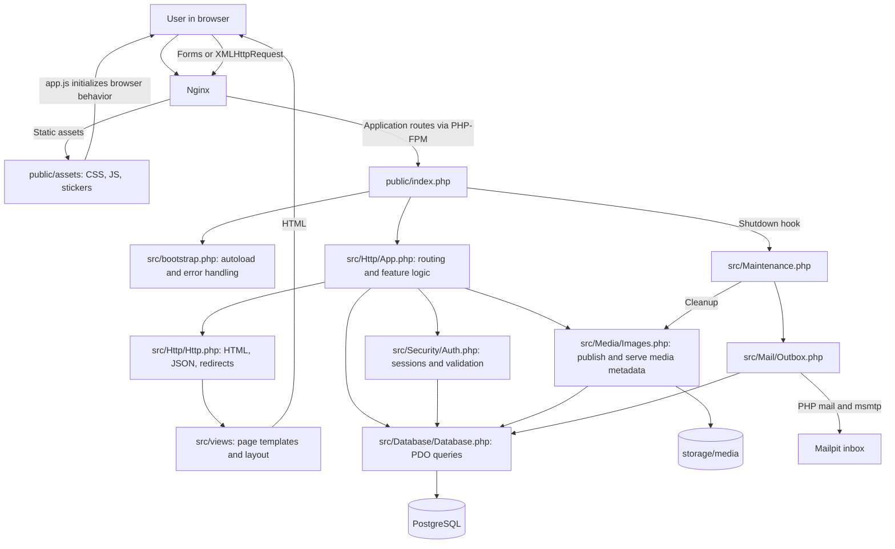
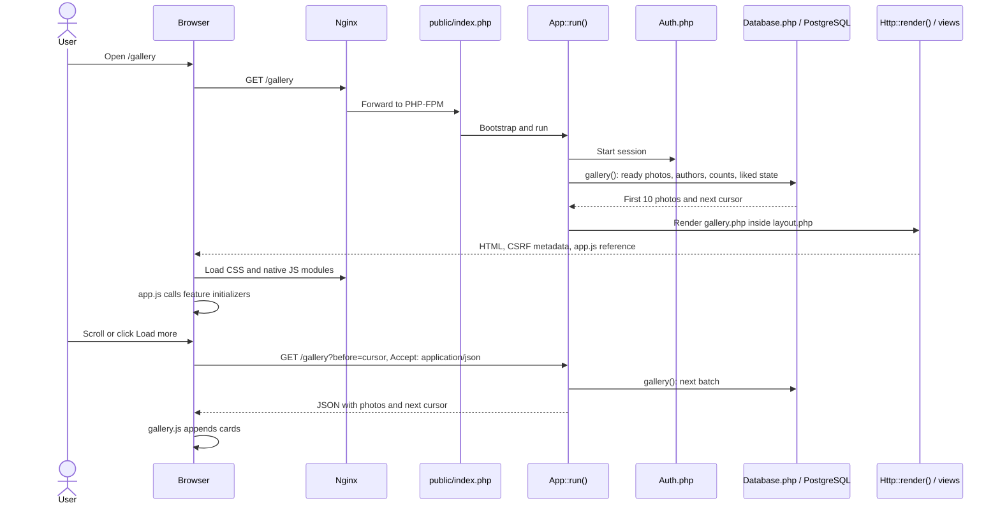
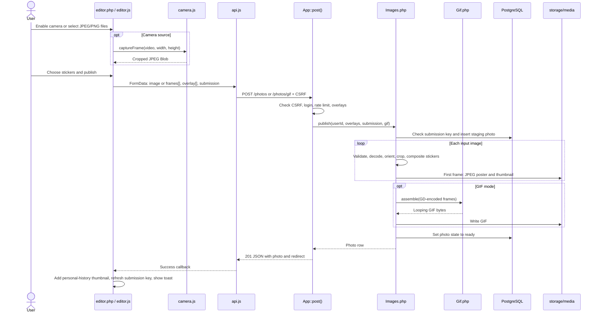
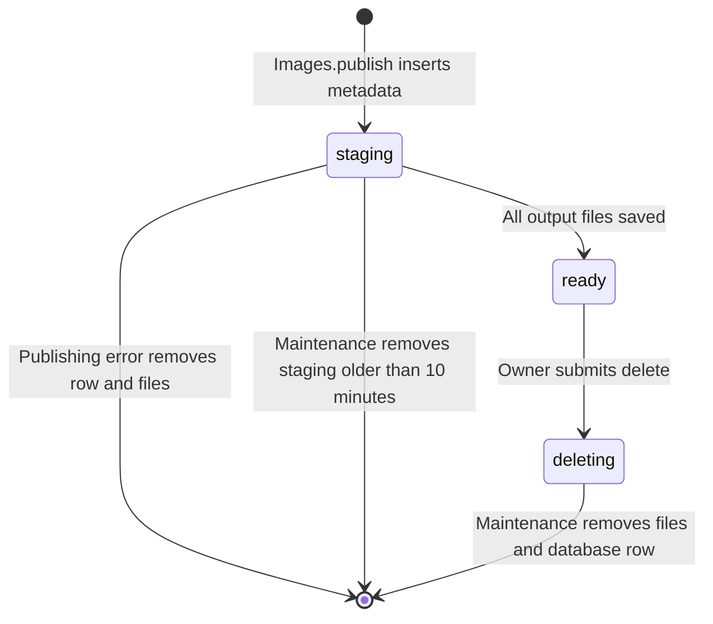
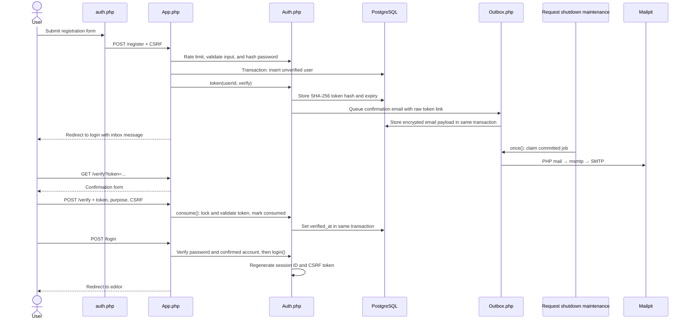
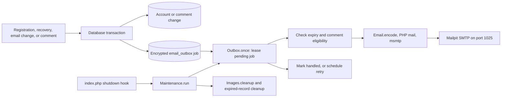
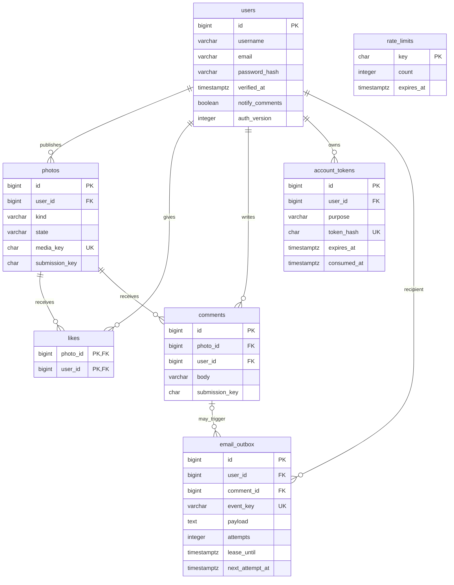
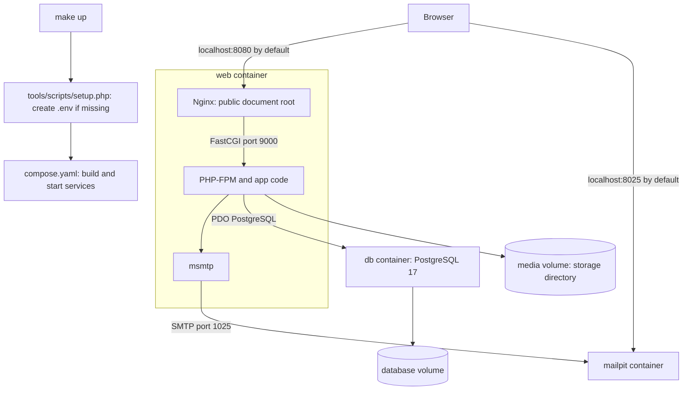

# Camagru architecture

This guide follows the app from the screen a user sees to the JavaScript, PHP, database, and files that make it work. Paths link to the implementation in this repository.

## 1. The whole app

Camagru is a server-rendered PHP 8.4 app with PostgreSQL and native JavaScript modules. PHP builds the initial HTML; JavaScript adds camera capture, previews, gallery loading, and form updates. There is no JavaScript build step or framework router.

The main feature coordinator is [`App.php`](src/Http/App.php). Its methods contain routing, SQL, and business decisions directly. [`Database.php`](src/Database/Database.php) provides connection, prepared-query, and transaction helpers; it does not define models or feature-specific repositories.

## 2. From a page request to visible UI

- [`public/index.php`](public/index.php) is the front controller: it boots the app, catches exceptions, formats errors, and registers request maintenance.
- [`src/bootstrap.php`](src/bootstrap.php) maps `Camagru\...` classes to `src/`, sets UTC, and converts reportable PHP errors into exceptions.
- [`App::run()`](src/Http/App.php) sets HTTP security headers, starts the session, chooses the route, and checks CSRF for POST requests. HEAD requests use GET handling.
- [`Http::render()`](src/Http/Http.php) renders the selected page, then inserts it into [`layout.php`](src/views/layout.php). The layout supplies navigation, CSRF metadata, stylesheets, notifications, and the module entry point.
- [`app.js`](public/assets/js/app.js) calls `initUi`, `initAuth`, `initGallery`, `initPhoto`, and `initEditor`. Initializers use matching elements or delegated events to attach behavior.

## 3. Which screen uses which code?

All application routes below are handled in [`src/Http/App.php`](src/Http/App.php). `{id}` means a positive numeric photo ID.

| User-facing screen or action | UI and browser code | Route and PHP responsibility |
| --- | --- | --- |
| Home | [`home.php`](src/views/home.php) | `GET /` → `run()` renders the home page. |
| Public gallery | [`gallery.php`](src/views/gallery.php), [`partials/card.php`](src/views/partials/card.php), [`gallery.js`](public/assets/js/gallery.js) | `GET /gallery` → `gallery()` selects ready photos; returns HTML or JSON according to `Accept`. |
| Photo and comments | [`photo.php`](src/views/photo.php), [`photo.js`](public/assets/js/photo.js) | `GET /photos/{id}` → `photo()` loads a ready photo; `run()` loads comments in pages of 20. |
| Editor and personal history | [`editor.php`](src/views/editor.php), [`editor.js`](public/assets/js/editor.js), [`camera.js`](public/assets/js/camera.js), [`gallery.js`](public/assets/js/gallery.js) | `GET /editor` requires login and loads owner history; `GET /editor/photos` serves owner-filtered history as HTML or JSON. |
| Publish photo or GIF | Editor forms and `editor.js` | `POST /photos` or `/photos/gif` → `post()` checks login and limits, then calls `Images::publish()`. |
| Sticker catalog | Editor template reads `Images::OVERLAYS`; browser previews PNG assets | `GET /overlays` also exposes that catalog as JSON. |
| Like / unlike | Card or photo form; delegated handler in `photo.js` | `POST /photos/{id}/like` or `/unlike` → `interact()` updates `likes` and returns liked state and count. |
| Add comment | Photo form and `photo.js` | `POST /photos/{id}/comments` → `interact()` validates and inserts a comment; optionally queues email. |
| Delete own comment | Photo template, `photo.js`, confirmation dialog | `POST /photos/{id}/comments/{commentId}/delete` → `post()` deletes only a comment owned by the current user. |
| Delete own creation | Photo menu and `photo.js` | `POST /photos/{id}/delete` → `interact()` checks ownership and marks the photo `deleting`; maintenance removes files and row. |
| Register, login, recovery, confirmation | [`auth.php`](src/views/auth.php), [`auth.js`](public/assets/js/auth.js) | GET renders `/register`, `/login`, `/forgot`, `/resend`, `/verify`, `/reset`; POST to those routes performs the action in `post()` with `Auth` helpers. |
| Logout | Form in `layout.php` | `POST /logout` → `Auth::logout()`, then home redirect. |
| Account settings | [`settings.php`](src/views/settings.php), `auth.js`; notification form handled by `photo.js` | `GET /settings`; POST `/settings/username`, `/settings/email`, `/settings/password`, `/settings/notifications` → `settings()`. |
| Image bytes | Image URLs in templates and generated cards | `GET /media/{id}/image`, `/thumb`, `/poster` → `media()` checks a ready photo and streams a file from private storage. |
| Error page | [`error.php`](src/views/error.php) | `public/index.php` catches failures and sends an HTML error or JSON error envelope. |
| Service readiness | No UI | `GET /health` runs `SELECT 1` and returns JSON; skips maintenance. |

### Shared browser responsibilities

| File | Responsibility |
| --- | --- |
| [`api.js`](public/assets/js/api.js) | `request()` sends XMLHttpRequest with `Accept: application/json` and a CSRF header on POST; interprets JSON success/errors. `token()` reads layout metadata; `randomKey()` creates submission keys. |
| [`ui.js`](public/assets/js/ui.js) | Toasts, form status and busy state, menu dismissal, dialog closing, and back navigation. |
| [`dom.js`](public/assets/js/dom.js), [`icons.js`](public/assets/js/icons.js) | DOM/SVG construction helpers and shared icon paths. |
| [`auth.js`](public/assets/js/auth.js) | Password visibility, password-rule feedback and confirmation checks, settings navigation state. Server-side validation remains in `Auth.php`. |
| [`photo.js`](public/assets/js/photo.js) | Handles forms with `data-ajax` across the app, including gallery likes and notification preferences; also manages photo sharing and comment deletion confirmation. |
| [`style.css`](public/assets/css/style.css), [`theme.css`](public/assets/css/theme.css) | Shared styling and visual presentation; both are loaded by the layout. |

### HTML forms and JSON share the same endpoints

Authentication and most settings forms submit normally. Forms marked `data-ajax` are intercepted by `photo.js`; editor submissions use `editor.js`. [`Http::success()`](src/Http/Http.php) responds based on the request:

- With `Accept: application/json`: `{ok: true, data: {message, redirect, ...}}`. JavaScript decides how to update the screen or follow the redirect.
- With a normal form submission: store a flash message and send a `303` redirect.
- Failures caught by `index.php`: JSON `{ok: false, error: {code, message, fields}}` or an HTML error page. Expected native login errors redirect back to `/login` with a session-stored message.

## 4. Taking or uploading a photo / GIF

[`editor.js`](public/assets/js/editor.js) owns camera permission, source switching, photo/GIF mode, sticker previews, uploaded frame previews, and an eight-frame camera burst. [`camera.js`](public/assets/js/camera.js) only captures a centered crop into a canvas and encodes it as JPEG. Sticker previews are browser layers; the server applies the actual stickers to the saved output.

[`Images.php`](src/Media/Images.php) owns the authoritative pipeline:

1. `overlays()` accepts only catalog entries, removes duplicates, and preserves their order.
2. `publish()` validates the submission key and returns an existing ready result for a repeated submission. The database also enforces uniqueness per user.
3. `upload()` / `decode()` check uploaded-file provenance, actual MIME type, size, dimensions, decoding, and JPEG EXIF orientation.
4. `composite()` crops/resizes the source and layers sticker PNGs in picker order. Photos are **1280 × 960**; GIF frames are **480 × 360**.
5. The first composed frame produces a JPEG poster and **320 × 240** thumbnail. [`Gif::assemble()`](src/Media/Gif.php) combines server-generated GIF frames into a looping animation, normally 250 ms per frame.
6. Files are written through `.tmp` files and renamed; only then is the row marked `ready`. A caught publishing failure removes tracked output files and the staging row.

Each input is limited to 5 MiB, 12 megapixels, and 6000 pixels per side. A GIF requires 2–8 JPEG/PNG input frames, at most 20 MiB combined. The complete POST is limited to 24 MiB. Browser checks provide feedback; PHP enforces the constraints.

### Media storage and lifecycle

The database stores metadata and a random `media_key`. Encoded media lives outside `public/`:

| File under `storage/media/` | Served through |
| --- | --- |
| `{media_key}.jpg` | `/media/{id}/poster`; also `/media/{id}/image` for a photo |
| `{media_key}-thumb.jpg` | `/media/{id}/thumb` |
| `{media_key}.gif` | `/media/{id}/image` for a GIF |

[`App::media()`](src/Http/App.php) looks up a ready photo before streaming bytes. Gallery and individual photo queries also require `state='ready'`.

## 5. Accounts, sessions, and email confirmation

[`Auth.php`](src/Security/Auth.php) owns session cookies, CSRF/origin checks, current-user lookup, login requirements, rate limiting, input validation, Argon2id password hashing, and token creation/consumption. `App.php` decides which account action to perform and updates the relevant rows.

- Sessions are stored in `storage/sessions`; the cookie contains the session ID. `Auth::user()` checks that the user is verified and the session's `auth_version` matches the database.
- Sessions expire after 30 minutes idle or 24 hours total. Login and logout regenerate the session ID and CSRF token.
- Reset tokens last 30 minutes; confirmation and email-change tokens last 24 hours. Only token hashes are stored in `account_tokens`; the raw link is included in the encrypted outbox payload.
- Opening `/verify` or `/reset` renders a form. The POST consumes the token and makes the change inside a transaction.
- Password reset increments `auth_version` and logs the requester out. Changing a password in settings invalidates other sessions and refreshes the current session.
- Changing an email requires the current password and confirmation at the new address before the stored email changes. Changing username or notification preference does not require the current password.

## 6. Likes, comments, and request-driven maintenance

[`App::interact()`](src/Http/App.php) requires login and locks a ready photo row inside a database transaction. It inserts/removes likes, validates comments, or verifies ownership before marking a photo for deletion. Comment deletion has its own branch in `post()` and checks comment ownership in SQL.

Likes have a composite primary key, so one user can like a photo once. Comments have a unique `(user_id, submission_key)` to prevent duplicate inserts on retries. Comment text is limited to 1–1000 characters. If the owner's `notify_comments` setting is enabled, a newly inserted comment queues an email in the same transaction.

[`Email.php`](src/Mail/Email.php) builds account/comment messages, renders [`views/emails/message.php`](src/views/emails/message.php), and encodes plain-text/HTML mail. [`Outbox.php`](src/Mail/Outbox.php) encrypts queued payloads with `APP_KEY`, deduplicates by event key, leases jobs with `FOR UPDATE SKIP LOCKED`, and sends them through PHP `mail()`.

[`Maintenance::run()`](src/Maintenance.php) runs from the front controller's shutdown hook for non-health application requests whose response status is below 500. It processes at most five outbox jobs, then acquires a PostgreSQL advisory lock for file cleanup and expired rate-limit/token cleanup. There is no separate worker or scheduler in the current Compose setup: pending delivery retries and cleanup depend on subsequent application requests.

Delivery failures retry with exponential delays starting at 30 seconds; after five failed attempts the job is marked failed. Before sending comment mail, the outbox rechecks that the comment exists, the photo is ready, and the owner still wants notifications. Handled jobs have their payload cleared; expired or ineligible messages are skipped.

## 7. Database relationships

Defined in [`src/Database/schema.sql`](src/Database/schema.sql):

This diagram shows selected columns. `rate_limits` is independent: its key is an HMAC of an action and an IP address or other subject. Username/email uniqueness is case-insensitive. Deleting a photo row cascades to its likes and comments; deleting a comment cascades to its linked outbox records.

## 8. Local runtime and infrastructure

| File | Responsibility |
| --- | --- |
| [`compose.yaml`](compose.yaml) | Defines `web`, `db`, and `mailpit`, ports, health checks, dependencies, and persistent `database` / `media` volumes. |
| [`tools/docker/Dockerfile`](tools/docker/Dockerfile) | Builds PHP-FPM with Nginx, GD, PostgreSQL PDO, EXIF, mbstring, sodium, and msmtp; copies app code and prepares storage. |
| [`tools/docker/nginx/nginx.conf`](tools/docker/nginx/nginx.conf) | Serves assets, routes application URLs to `public/index.php`, and permits only that PHP entry point to execute. |
| [`tools/docker/start-web.sh`](tools/docker/start-web.sh) | Starts and supervises Nginx and PHP-FPM; stops both if either exits. |
| [`tools/docker/php/php.ini`](tools/docker/php/php.ini), [`fpm.conf`](tools/docker/php/fpm.conf) | Upload/runtime limits, session and log storage, PHP mail transport, and FPM configuration. |
| [`tools/docker/mail/msmtprc`](tools/docker/mail/msmtprc) | Routes outgoing mail to Mailpit SMTP. |
| [`src/Config.php`](src/Config.php) | Reads environment variables and supplies repository root, storage, and absolute app URLs. |
| [`tools/scripts/setup.php`](tools/scripts/setup.php), [`.env.example`](.env.example) | Create missing local configuration with generated secrets. |
| [`Makefile`](Makefile) | `make up`, `make down`, `make logs`, and `make test`. |

The `media` volume mounts the entire `storage/` directory, including media, temporary storage, sessions, and PHP logs. PostgreSQL initializes a new database volume from `schema.sql`. App source is copied into the image, so code changes require rebuilding with `make up` in this setup.

## 9. Where to start when changing a feature

| Intended change | Start here |
| --- | --- |
| Page markup or navigation | Relevant `src/views/*.php`; shared shell in `layout.php`. |
| Visual styling | `public/assets/css/style.css` and `theme.css`. |
| Camera, source switching, GIF preview, editor state | `editor.js`; canvas capture in `camera.js`. |
| Sticker selection or output composition | `editor.php`, `editor.js`, `Images::OVERLAYS`, `Images::composite()`, and `public/assets/images/overlays/`. |
| Gallery ordering, filters, pagination | `App::gallery()` and `App::select()`; loading behavior in `gallery.js`. |
| Likes, comments, deletion | `App::interact()` / `post()`, the relevant template, and `photo.js`. |
| Account rules, sessions, tokens | `Auth.php` plus the relevant branch in `App::post()` or `settings()`. |
| Email design or delivery | `Email.php`, `views/emails/message.php`, `Outbox.php`, and `Maintenance.php`. |
| Data structure or constraints | `schema.sql`; existing database volumes need an explicit schema update because initialization only runs on new volumes. |

[`tools/scripts/test-overlays.php`](tools/scripts/test-overlays.php), run with `make test` while containers are running, checks sticker validation and composition at photo and GIF resolutions. Its scope is the overlay pipeline, rather than the full UI/account flow.
