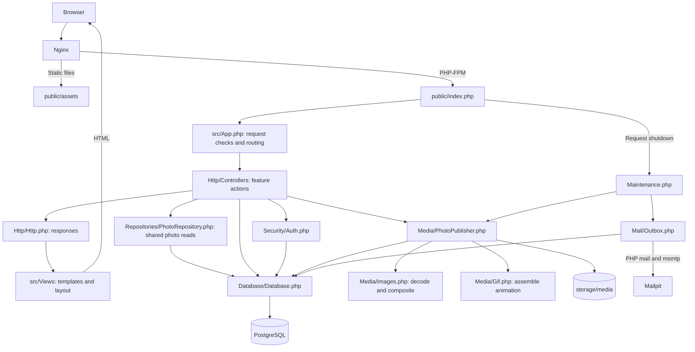
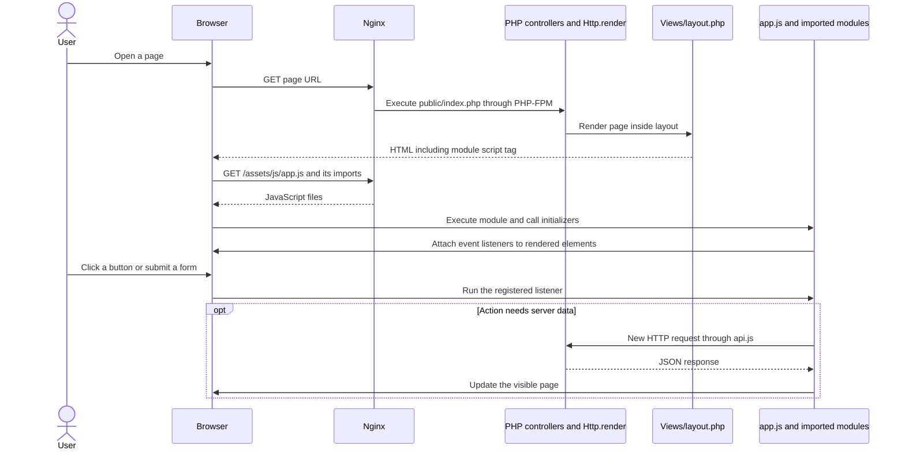
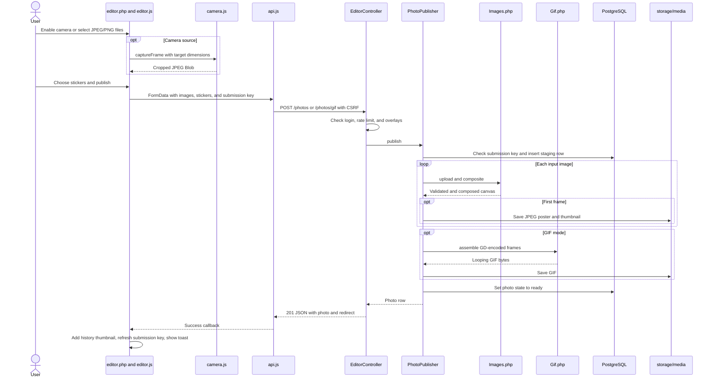
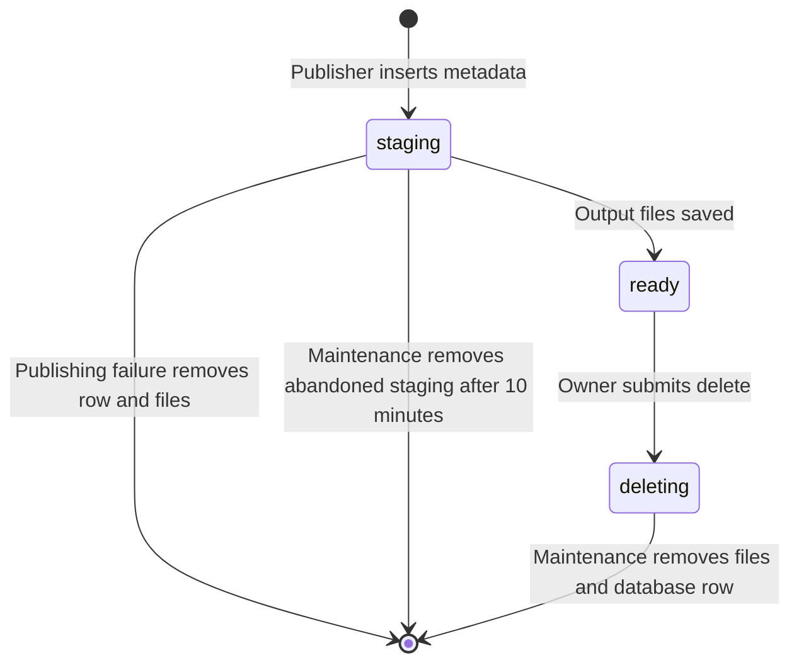
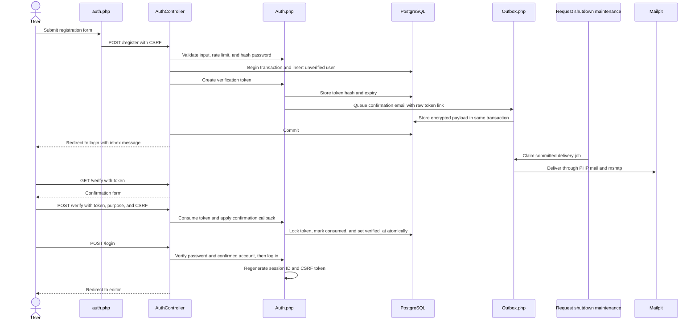
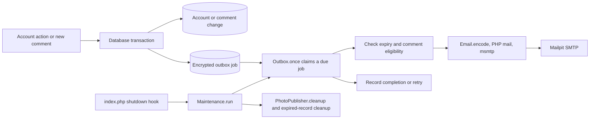
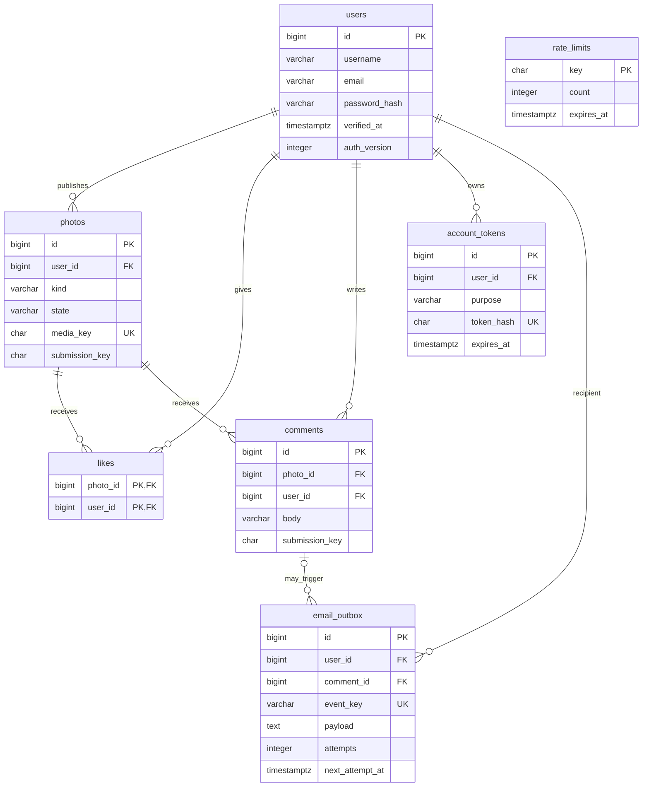
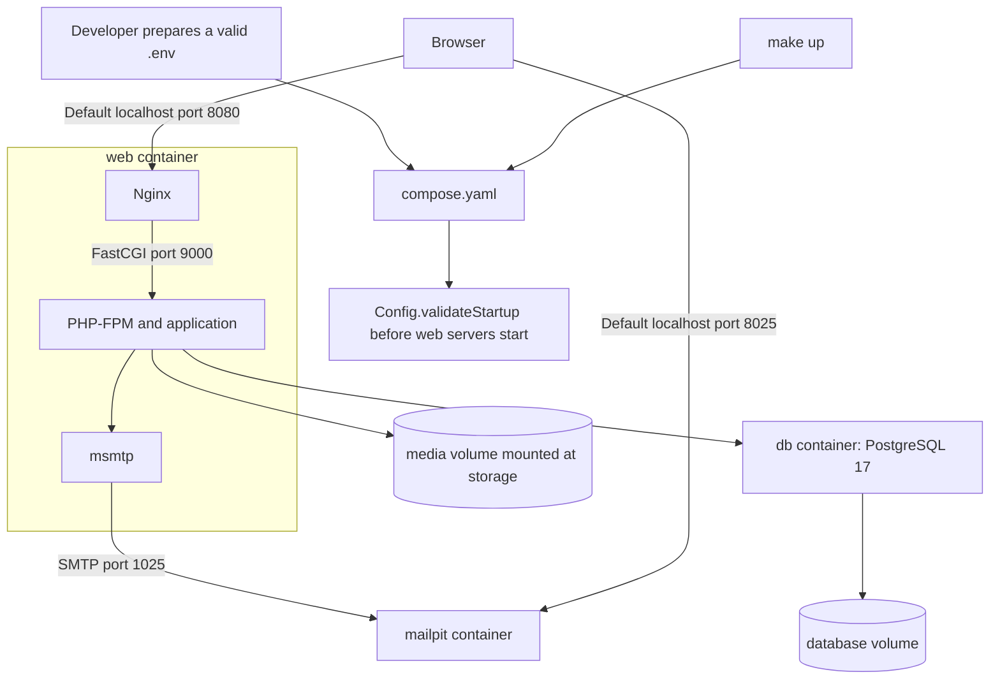

# Camagru architecture

This guide follows a user action from the browser UI through JavaScript, PHP, PostgreSQL, and media storage. Every linked path points to the implementation in this repository.

## 1. The whole app

Camagru uses PHP 8.4, PostgreSQL, and native JavaScript modules. PHP renders the initial page. JavaScript adds camera capture, previews, gallery loading, and form updates. There is no frontend build step.



[`App.php`](src/App.php) dispatches URLs and applies shared checks. Feature behavior lives in [`Http/Controllers/`](src/Http/Controllers/). Controllers use [`PhotoRepository.php`](src/Repositories/PhotoRepository.php) for shared photo reads and [`Database.php`](src/Database/Database.php) for other prepared queries and transactions. There is no ORM.

## 2. How PHP gets JavaScript running in the browser

**PHP generates HTML. The browser reads that HTML, downloads JavaScript, and executes it.** PHP does not directly call JavaScript functions.

[`Http::render()`](src/Http/Http.php) renders a page template inside [`layout.php`](src/Views/layout.php). The layout includes this module entry point:

```html
<script type="module" src="/assets/js/app.js?v=24"></script>
```

The query parameter versions the entry URL. The browser requests this file from Nginx, then downloads its imported modules. Module scripts execute after the HTML has been parsed, so the initializers can find the page's elements.

[`app.js`](public/assets/js/app.js) imports and calls `initUi()`, `initAuth()`, `initGallery()`, `initForms()`, `initSettings()`, `initPhoto()`, and `initEditor()`. An initializer attaches event listeners to matching elements or uses delegated events on `document`. For example, `initEditor()` returns immediately unless it finds `#editor`.



Changing a button's HTML starts in a PHP view. Changing what happens when it is clicked starts in the JavaScript module that registers its listener.

## 3. Which screen uses which code?

All URLs are dispatched in [`App.php`](src/App.php). `{id}` denotes a positive numeric photo ID. All POST requests pass the shared CSRF check before reaching a controller.

| Screen or action | Template / browser behavior | Responsible PHP code |
| --- | --- | --- |
| Home: `GET /` | [home.php](src/Views/home.php) | `App::run()` renders the page. |
| Gallery: `GET /gallery` | [gallery.php](src/Views/gallery.php), [partials/card.php](src/Views/partials/card.php), [gallery.js](public/assets/js/gallery.js) | [GalleryController::show()](src/Http/Controllers/GalleryController.php) and `PhotoRepository::gallery()`. |
| Editor: `GET /editor` | [editor.php](src/Views/editor.php), [editor.js](public/assets/js/editor.js), [camera.js](public/assets/js/camera.js) | [EditorController::show()](src/Http/Controllers/EditorController.php) requires login and loads personal history. |
| Personal history: `GET /editor/photos` | History grid and `gallery.js` | `GalleryController::show(true)` returns owner-filtered HTML or JSON. |
| Sticker catalog: `GET /overlays` | Editor reads the same catalog directly while rendering | `EditorController::overlays()` exposes `Images::OVERLAYS` as JSON. |
| Publish: `POST /photos` or `/photos/gif` | Editor forms and `editor.js` | `EditorController::publish()` checks login and limits, then calls `PhotoPublisher::publish()`. |
| Photo: `GET /photos/{id}` | [photo.php](src/Views/photo.php), [photo.js](public/assets/js/photo.js), [forms.js](public/assets/js/forms.js) | [PhotoController::show()](src/Http/Controllers/PhotoController.php) loads a ready photo and comments in pages of 20. |
| Like/unlike: `POST /photos/{id}/like` or `/unlike` | Card/photo form and `forms.js` | `PhotoController::interact()` saves liked state and returns its count. |
| Comment: `POST /photos/{id}/comments` | Photo form and `forms.js` | `PhotoController::interact()` inserts a comment and optionally queues email. |
| Delete comment: `POST /photos/{id}/comments/{commentId}/delete` | Photo template, dialog, and `forms.js` | `PhotoController::deleteComment()` permits only the comment's owner. |
| Delete creation: `POST /photos/{id}/delete` | Photo menu and `forms.js` | `PhotoController::interact()` checks ownership and marks the photo `deleting`. |
| Accounts: `/register`, `/login`, `/forgot`, `/resend`, `/verify`, `/reset` | [auth.php](src/Views/auth.php), [auth.js](public/assets/js/auth.js) | [AuthController](src/Http/Controllers/AuthController.php): GET → `show()`; POST → `register()`, `login()`, `requestEmail()`, `verify()`, or `reset()`. |
| Logout: `POST /logout` | Navigation form in `layout.php` | `AuthController::logout()`. |
| Settings: `GET /settings` | [settings.php](src/Views/settings.php), [settings.js](public/assets/js/settings.js), password visibility in `auth.js` | [SettingsController::show()](src/Http/Controllers/SettingsController.php). |
| Update settings: POST `/settings/username`, `/email`, `/password`, `/notifications` | Settings forms, notification AJAX handled by `forms.js` | `SettingsController::update()` applies the selected preference. Each URL includes the `/settings` prefix. |
| Media: `GET /media/{id}/image`, `/thumb`, `/poster` | Image URLs in templates/cards | `PhotoController::media()` streams files only for ready photos. |
| Health: `GET /health` | No UI | `App::run()` executes `SELECT 1` and returns JSON without maintenance. |
| Errors | [error.php](src/Views/error.php) or form feedback | [public/index.php](public/index.php) catches failures and formats HTML or JSON. |

### Shared browser code

| Module | Responsibility |
| --- | --- |
| [app.js](public/assets/js/app.js) | Import modules and call their initializers. |
| [api.js](public/assets/js/api.js) | XMLHttpRequest, JSON responses, CSRF header, and random submission keys. |
| [forms.js](public/assets/js/forms.js) | Handle forms marked `data-ajax`, including likes, comments, deletion, and notification preferences. |
| [photo.js](public/assets/js/photo.js) | Photo sharing popover and copying links/embed snippets. |
| [settings.js](public/assets/js/settings.js) | Settings sidebar selection. |
| [auth.js](public/assets/js/auth.js) | Password visibility and account password-rule feedback. |
| [ui.js](public/assets/js/ui.js) | Toasts, busy/status messages, menus, dialogs, and back navigation. |
| [dom.js](public/assets/js/dom.js), [icons.js](public/assets/js/icons.js) | Shared DOM/SVG construction and icon definitions. |
| [style.css](public/assets/css/style.css), [theme.css](public/assets/css/theme.css) | Shared layout and visual styling, loaded by `layout.php`. |

### HTML forms and JSON use the same endpoints

Authentication and most settings forms submit normally. `forms.js` intercepts `data-ajax` forms, while `editor.js` handles publishing. [`Http::success()`](src/Http/Http.php) responds according to `Accept`:

- `application/json`: `{ok: true, data: {message, redirect, ...}}`. JavaScript decides how to update the screen or follow a redirect.
- Normal form: store a flash message and issue a `303` redirect.
- Errors caught by `index.php`: JSON `{ok: false, error: {code, message, fields}}` or an HTML error page. Expected native login errors redirect to `/login` with a session-stored message.

## 4. Taking or uploading a photo / GIF



[`editor.js`](public/assets/js/editor.js) owns camera permission, source switching, modes, sticker previews, uploaded frame previews, and eight-frame camera bursts. [`camera.js`](public/assets/js/camera.js) center-crops video to a canvas and encodes a JPEG Blob. Browser sticker layers provide a preview. PHP applies the actual layers to the saved output.

[`Images.php`](src/Media/Images.php) handles image operations:

- `overlays()` validates catalog entries and removes duplicates while preserving order.
- `upload()` checks PHP upload provenance. `decode()` checks MIME, size, dimensions, decoding, and JPEG EXIF orientation.
- `composite()` crops/resizes and applies sticker layers. Photos are **1280 × 960**; GIF frames are **480 × 360**.

[`PhotoPublisher.php`](src/Media/PhotoPublisher.php) coordinates persistence:

1. Validate the submission key and return an existing ready result for a retry. The database enforces uniqueness per user.
2. Insert a `staging` row and process the uploaded images with `Images`.
3. Save a first-frame JPEG poster and **320 × 240** thumbnail. For GIFs, [`Gif::assemble()`](src/Media/Gif.php) combines server-generated frames into a looping animation, normally 250 ms per frame.
4. Write files through temporary paths and rename them, then mark the row `ready`. A caught failure removes tracked outputs and the staging row.

Each input is limited to 5 MiB, 12 megapixels, and 6000 pixels per side. GIFs require 2–8 JPEG/PNG frames, at most 20 MiB combined. The complete POST is limited to 24 MiB. PHP enforces these limits independently of browser feedback.

### Media files and lifecycle

The database stores metadata and a random `media_key`. Encoded files live outside `public/`:

| File under `storage/media/` | URL |
| --- | --- |
| `{media_key}.jpg` | `/media/{id}/poster`, and `/media/{id}/image` for a photo |
| `{media_key}-thumb.jpg` | `/media/{id}/thumb` |
| `{media_key}.gif` | `/media/{id}/image` for a GIF |

`PhotoRepository::find()` and `gallery()` expose only ready rows. `PhotoController::media()` checks the row before streaming bytes.



## 5. Accounts, sessions, and confirmation



[`AuthController.php`](src/Http/Controllers/AuthController.php) coordinates account actions. [`Auth.php`](src/Security/Auth.php) owns session cookies, CSRF/origin checks, current-user lookup, login requirements, rate limits, validation, Argon2id hashing, and token creation/consumption. [`SettingsController.php`](src/Http/Controllers/SettingsController.php) coordinates preference changes.

- Sessions live in `storage/sessions`. Cookies hold a session ID. `Auth::user()` checks verification and compares session `auth_version` against the database.
- Sessions expire after 30 minutes idle or 24 hours total. Login/logout regenerate session IDs and CSRF tokens.
- Reset tokens expire after 30 minutes. Confirmation/email-change tokens last 24 hours. `account_tokens` stores hashes, while raw links are included in encrypted email payloads.
- GET `/verify` or `/reset` renders a form. POST consumes the token and applies the change inside a transaction.
- Password reset increments `auth_version` and signs the requester out. Changing a password in settings invalidates other sessions while refreshing the current session.
- Email changes require the current password and confirmation at the new address. Username and notification changes do not require the current password.

## 6. Likes, comments, and request-driven maintenance

[`PhotoController::interact()`](src/Http/Controllers/PhotoController.php) requires login and locks a ready photo in a transaction. Likes use a composite primary key. Comments accept 1–1000 characters and have a unique `(user_id, submission_key)` to deduplicate retries. A new comment queues mail in the same transaction when the owner has notifications enabled. `deleteComment()` checks ownership in its DELETE query.



[`Email.php`](src/Mail/Email.php) builds account/comment messages, renders [`Views/emails/message.php`](src/Views/emails/message.php), and encodes plain-text/HTML mail. [`Outbox.php`](src/Mail/Outbox.php) encrypts payloads with `APP_KEY`, deduplicates events, leases jobs with `FOR UPDATE SKIP LOCKED`, and sends through PHP `mail()`.

[`Maintenance::run()`](src/Maintenance.php) runs at shutdown for non-health application requests with response status below 500. It processes at most five outbox jobs, then uses a PostgreSQL advisory lock to serialize media cleanup and expired rate-limit/token cleanup. There is no separate worker: retries and cleanup depend on application requests.

Mail failures retry with exponential delays starting at 30 seconds and stop after five failed attempts. Comment delivery rechecks that the comment exists, its photo is ready, and its owner still wants notifications. Handled jobs have their payload cleared. Expired/ineligible messages are skipped.

## 7. Database relationships

Defined in [`schema.sql`](src/Database/schema.sql):



Selected columns are shown. `rate_limits` is independent: its key is an HMAC of action and subject. Username/email uniqueness is case-insensitive. Photo deletion cascades to likes/comments, and comment deletion cascades to linked outbox rows. Photo and comment submission keys are unique per user.

## 8. Folders, runtime, and infrastructure

```text
src/
├── bootstrap.php                 Class loading, UTC, PHP error conversion
├── App.php                       Routing and shared request checks
├── Config.php                    Environment values and filesystem/URL paths
├── Maintenance.php               Request-driven delivery and cleanup
├── Http/
│   ├── Http.php                  HTML, JSON, redirects, escaping, headers
│   ├── HttpError.php             Expected HTTP failures
│   └── Controllers/              Account, settings, gallery, editor, photo actions
├── Repositories/
│   └── PhotoRepository.php       Shared photo lookup and pagination
├── Database/
│   ├── Database.php              PDO and transactions
│   └── schema.sql                Initial database schema
├── Security/Auth.php             Sessions, passwords, CSRF, tokens, rate limits
├── Media/
│   ├── Images.php                Decode, crop, resize, stickers
│   ├── PhotoPublisher.php        Publishing, files, database state, cleanup
│   └── Gif.php                   Generated-frame animation assembly
├── Mail/                         Email templates/encoding and encrypted outbox
└── Views/                        PHP pages, shared partials, email template
public/
├── index.php                     Front controller and error boundary
└── assets/                       Native JS modules, CSS, images
storage/                          Private runtime files in Docker volume
docker/                          Container build and runtime configuration
```



| File | Responsibility |
| --- | --- |
| [compose.yaml](compose.yaml) | Services, ports, health checks, startup dependencies, persistent database/media volumes. |
| [Dockerfile](docker/Dockerfile) | PHP-FPM, Nginx, GD, PostgreSQL PDO, EXIF, mbstring, sodium, msmtp, copied source, and storage setup. |
| [nginx.conf](docker/nginx/nginx.conf) | Serve assets and route app URLs to the only executable PHP entry point, `public/index.php`. |
| [start-web.sh](docker/start-web.sh) | Validate environment, start/supervise Nginx and PHP-FPM, and stop both if either exits. |
| [php.ini](docker/php/php.ini), [fpm.conf](docker/php/fpm.conf) | Runtime/upload limits, session/log paths, PHP mail transport, and FPM settings. |
| [msmtprc](docker/mail/msmtprc) | Route SMTP to Mailpit. |
| [Config.php](src/Config.php), [.env.example](.env.example) | Read and validate developer-supplied environment configuration. Startup requires an existing .env file and rejects missing values or placeholder secrets. |
| [Makefile](Makefile) | Start, stop, and log commands. |

The `media` volume contains the whole `storage/` directory, including media, sessions, temporary files, and PHP logs. PostgreSQL initializes a new database volume using `schema.sql`. Existing volumes require an explicit schema update when the schema changes. This refactor changes no database schema. Source is copied into the image, so rebuild with `make up` after code changes.

## 9. Where to start when changing a feature

| Change | Start here |
| --- | --- |
| Page content/navigation | Relevant `src/Views` template and shared `layout.php`. |
| Visual styling | `public/assets/css/style.css` and `theme.css`. |
| Browser startup | `layout.php` script tag → `app.js` imports/initializers. |
| Camera/editor behavior | `editor.js` and `camera.js`. |
| Stickers | `editor.php`, `editor.js`, `Images::OVERLAYS`, `Images::composite()`, and `public/assets/images/overlays/`. |
| New/changed URL | `App.php` dispatch, then the responsible controller. |
| Gallery/history ordering or pagination | `PhotoRepository::gallery()` and `gallery.js`. |
| Likes/comments/delete | `PhotoController`, the template, and `forms.js`. |
| Sharing | `photo.php` and `photo.js`. |
| Accounts/settings | `AuthController` or `SettingsController`, `Auth.php`, and the matching template/browser module. |
| Media publication | `EditorController::publish()` → `PhotoPublisher::publish()` → `Images` / `Gif`. |
| Email | `Email.php`, `Views/emails/message.php`, `Outbox.php`, and `Maintenance.php`. |

Functions carry short comments explaining their purpose. Comments around non-obvious steps explain retry safety, authorization, file lifecycle, or transaction boundaries.
